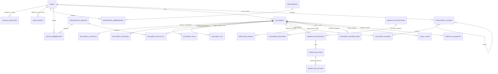
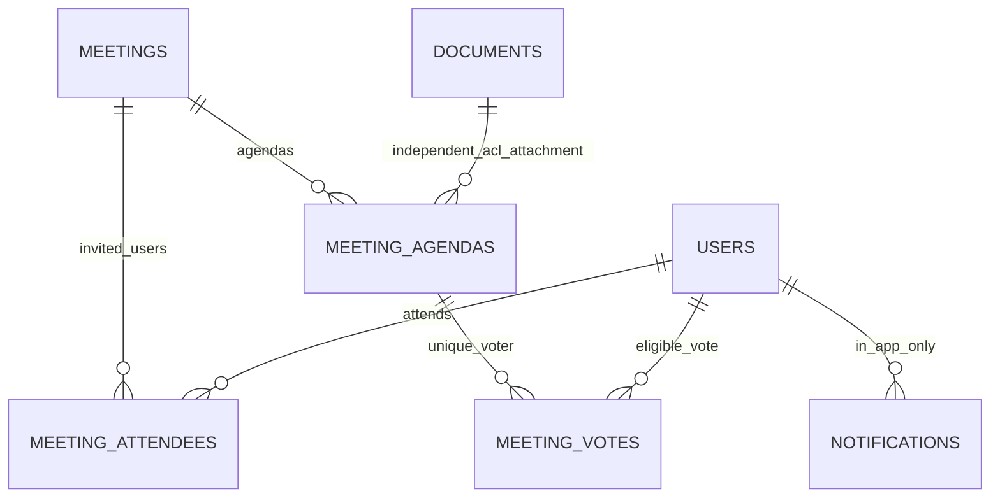

# Implemented ERD — TEST0.2

Canonical SQL is migrations001–004 (39 tables on the executed local target). The diagrams show domain relationships, not every column. All mutable state uses InnoDB transactions; no cascade-delete of released records.

Additional tables: sessions (hashed random lookup IDs, no Google tokens); auth_nonces (one-use replay guard); verified_access_requests (verified subject/email, no automatic approval); idempotency_keys (actor+scope+key); sequence_counters (type+Gregorian Bangkok year); document_templates (code+version); retention_policies (explicit years/basis); audit_events (append-only auth/base events); domain_events and domain_audit_head (serialized local hash chain).

Files are private encrypted objects, not BLOBs. Runtime DB account cannot modify revisions/actions/signatures/domain events. Storage keys/backups are not in Git. UTC DB timestamps; frontend displays Thai/Buddhist Era dates in Asia/Bangkok. Restore evidence validates all39 SQL tables; it does not establish file-object/offsite recovery.
